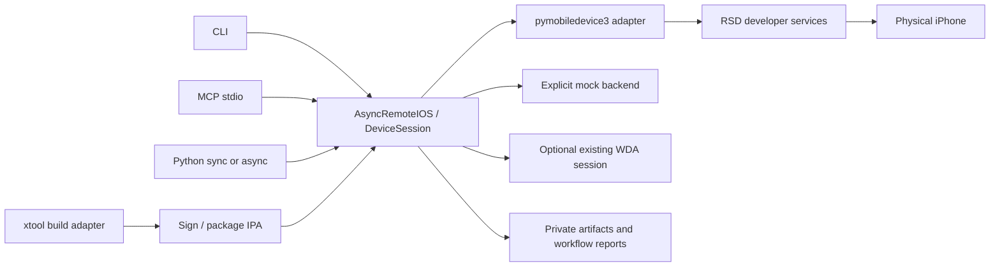

# Architecture

The canonical interface is the `remote-ios` CLI. CLI, Python, and MCP call the same asynchronous `DeviceSession` methods. Agent branding and prompts live under examples/docs, not device backends.

## Boundaries

- `core`: configuration, dataclasses, errors, bounded subprocess execution.
- `connectivity`: explicit USB, pre-existing RSD, and RemotePairing transports. Pairing is an intentional provisioning step; ordinary connections use `autopair=False`.
- `devices`: backend protocol, native adapter, and explicitly selected simulation.
- `automation`: pixel-to-native coordinate conversion, optional WDA client.
- `capture`: screenshots, sidecars, ROI comparison, periodic frames, sampled video.
- `deployment`: IPA metadata and packaging; device installation/launch live in the backend.
- `build`: optional external xtool and zsign process adapters. No shell command concatenation.
- `api`: asynchronous sessions and a context-managed synchronous facade.
- `workflows`: bounded steps and checkpointed JSON reports.
- `mcp`: tools wrapping the same API, serialized because the upstream userspace stack supports one tunnel per process.
- `sdk`: independently licensed local development action/state registry. Network transport and feedback ingestion are not implemented in 0.1.

## Sessions and failure semantics

Connections exist within the current process. `device connect` probes and closes; `--hold N` keeps the process alive for a bounded time. It does not create a global background session. `device disconnect` explains that the owning process must exit. Python contexts and workflows retain the connection across operations; HID interaction contexts retain the media stream across gestures.

A device operation deadline has an **unknown possible effect**. The toolkit does not automatically replay installation or input events. Capture/reconnect and inspect before deciding to retry. RSD identity must match the configured identifier. Multiple devices require selection; no first-device fallback is performed implicitly.

The workflow runner preserves completed artifacts, stops on the first error, honors an optional stop-file between steps, and enforces a total deadline/action count. A new run may resume from a caller-chosen step after reviewing evidence. Automatic resumption and background reconnection are not implemented.

`ok` reports command execution, while action `status=dispatched` and `verified=false` describe the weaker interaction evidence. Pixel differences are labeled `visual_change_only`; an app-level condition requires WDA or a future SDK assertion. `simulated=true` propagates through mock device artifacts, actions, and workflows.

## Transport topology

RemotePairing is a TCP/QUIC control endpoint on the phone's tailnet/LAN address. It creates an Apple tunnel, whose RSD address advertises individual developer service ports. Those are different addresses and protocols. An HTTP forward or Tailscale ping is insufficient. HID additionally requires the phone to send media back to the receiver, so the reverse route matters.

USB uses pymobiledevice3's no-root preferred tunnel. Direct remote RemotePairing currently uses a kernel tunnel and needs a TUN interface/capability. An explicit RSD transport assumes the user has already made its entire tunnel network routable. It does not forward only the RSD port and assume every other service works.
